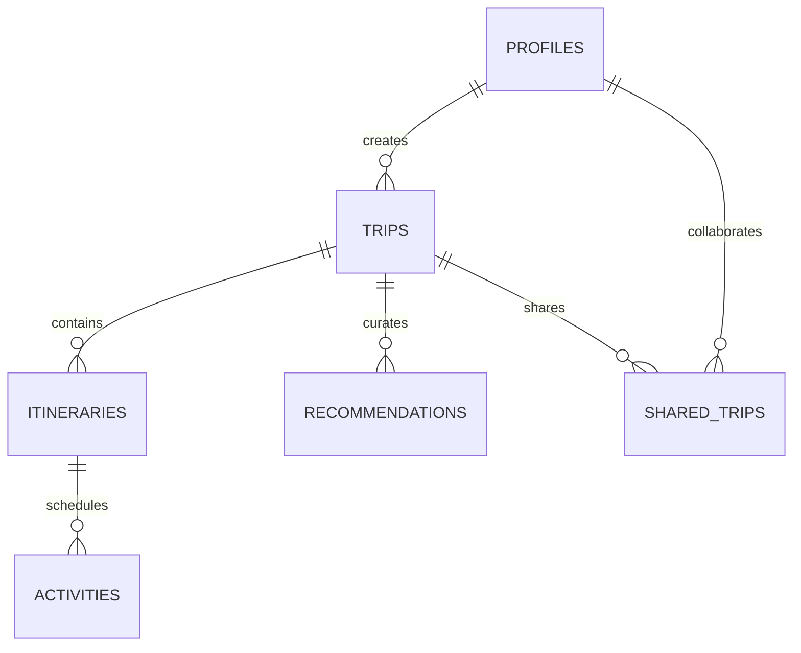

# Database Design & Schema

The WanderAI persistence model is built on top of PostgreSQL with Supabase, leveraging relational integrity and Row-Level Security (RLS).

## Entity Relationship Diagram

## Tables
1. **profiles**: User preferences, avatar, and metadata tied to `auth.users`.
2. **trips**: Primary travel metadata including destination, date ranges, budget, travel style, and pace.
3. **itineraries**: Day-by-day records (`day_number`, `date`, summary, food recommendations JSON, transportation JSON).
4. **activities**: Time, coordinates (`latitude`, `longitude`), duration, cost, and description.
5. **recommendations**: Curated list of attractions, restaurants, hotels, and transportation.
6. **shared_trips**: Collaboration records with role assignment (`owner`, `editor`, `viewer`).
