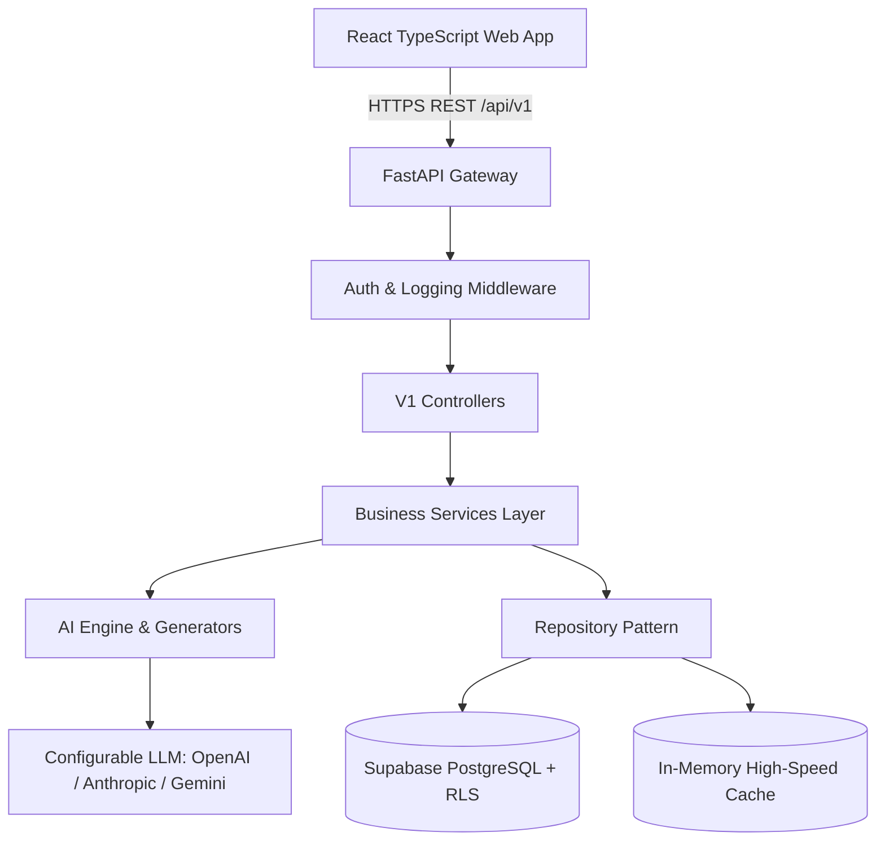

# System Architecture

## Overview
WanderAI is a decoupled full-stack platform consisting of a React 18 / TypeScript single-page application and a high-performance Python FastAPI backend backed by PostgreSQL / Supabase and multi-provider AI agents.

## Layers
1. **Frontend Presentation**: Single-Page App utilizing Tailwind CSS, Lucide icons, Leaflet for cartography, and Recharts for cost breakdowns.
2. **API & Security**: FastAPI with JWT verification, CORS control, and strict Pydantic payload validation.
3. **Controller-Service-Repository**: Clear separation of HTTP handling, business orchestration, and storage abstraction.
4. **AI Generation Engine**: Modular prompt construction, structured output parsing, markdown fence sanitization, and fallback synthesis.
5. **Data Persistence**: Supabase PostgreSQL tables fortified by Row-Level Security (RLS) policies.
